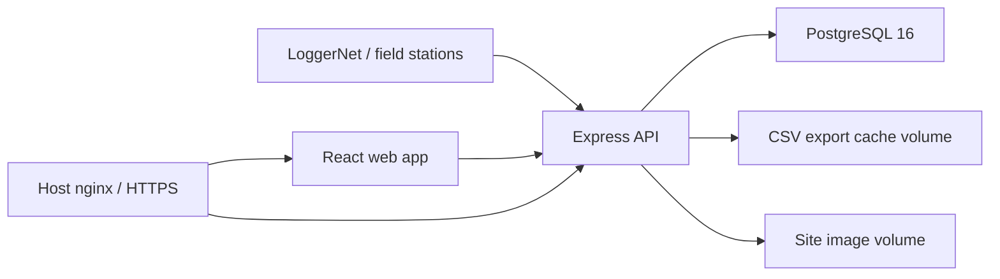

# SAEON Observations Monitor

The SAEON Observations Monitor is the public and technician-facing interface for LoggerNet weather and eddy covariance observations. It ingests raw LoggerNet data, maps technical server/table/field names into public site datasets, provides availability summaries, supports bounded downloads and JSON API access, and exposes technician workflows for mapping, site assets, backfills, and operational checks.

## What Is In This Repository

- `api/` - Express API, background sync jobs, public API routes, admin/mapping endpoints, CSV export generation, and image upload handling.
- `web/` - React frontend for Home, Data, Unified Mapping, Admin Panel, API Reference, Raw Data, Metadata Portal, Analytics, Issues, and About.
- `docker/` - PostgreSQL restore, optimization, status, backfill, and field-values partitioning scripts.
- `docker-compose.yml` - Local and production Docker stack for Postgres, API, and web.
- `DOCKER.md` - Docker deployment and restore notes.
- `FIELD_VALUES_PARTITIONING.md` - Runbook for the large `field_values` partition migration.

Generated exports, uploaded site images, database dumps, Docker volume archives, `node_modules`, and `.env` files are deliberately excluded from Git.

## Architecture



Default Docker ports are chosen so this stack can run beside older services during testing:

| Service | Container | Host port |
| --- | --- | --- |
| Web | `loggernet-web` | `3080` |
| API | `loggernet-api` | `3081` |
| Postgres | `loggernet-db` | `55432` |

## Local Setup

Create the Docker and API environment files from the examples, then fill in local or deployment secrets:

```bash
cp .env.example .env
cp api/.env.example api/.env
```

Install and build through Docker:

```bash
docker compose build
docker compose up -d
docker compose ps
```

Open the local web app at [http://localhost:3080](http://localhost:3080).

Useful smoke checks:

```bash
curl -i http://localhost:3080/
curl -s http://localhost:3081/api/public/site-status
curl -i http://localhost:3081/api/v1/sites
```

The `/api/v1/*` data API requires login. For local testing:

```bash
curl -c saeon-api.cookies \
  -H "Content-Type: application/json" \
  -d '{"username":"your-username","password":"your-password"}' \
  http://localhost:3081/api/login

curl -b saeon-api.cookies http://localhost:3081/api/v1/sites
```

Do not commit real passwords, OAuth client secrets, cookies, dumps, or Docker volume archives.

## Production Update Flow

On the server, keep the database and runtime data in Docker volumes. Keep the real `.env` and `api/.env` files on the server only. Pull code updates, rebuild the app containers, and leave the database volume intact:

```bash
cd /opt/saeon-observations-monitor-v2
git pull
docker compose build api web
docker compose up -d api web
docker compose ps
```

Check the app after each update:

```bash
curl -I http://localhost:3080/
curl -s http://localhost:3081/api/public/site-status
docker compose logs --tail=80 api
```

For the live domain from the server itself:

```bash
curl -k --resolve observationsmonitor.saeon.ac.za:443:127.0.0.1 \
  https://observationsmonitor.saeon.ac.za/api/public/site-status
```

## Background Jobs

The API runs the sync and export scheduler when `ENABLE_BACKGROUND_JOBS=true`.

- CSV pre-generation: disabled; downloads are generated on demand.
- Fast writer sync: Monday to Saturday at 06:00, 14:00, and 22:00 SAST.
- Sunday fast sync: 06:00 and 14:00 SAST.
- Sunday extended sync: 20:00 SAST.

Check status after logging in:

```bash
curl -b saeon-api.cookies http://localhost:3081/api/background-status
```

Start a once-off writer run:

```bash
curl -b saeon-api.cookies -X POST http://localhost:3081/api/background/run-writer
```

Only one writer run should hold the advisory lock at a time.

## Database Notes

The production database uses a partitioned `public.field_values` table. Do not remove or recreate the database volume during normal deployments.

Quick health checks:

```bash
docker compose exec db psql -U postgres -d loggernet -c \
"select pg_size_pretty(pg_database_size('loggernet')) as db_size;"

docker compose exec db psql -U postgres -d loggernet -c \
"select count(*) as partitions from pg_inherits where inhparent = 'public.field_values'::regclass;"

docker compose exec db psql -U postgres -d loggernet -c \
"select sync_time, last_data_availability_sync_time from public.last_synced where id = 1;"
```

See `FIELD_VALUES_PARTITIONING.md` before attempting any field-values migration work.

## Public API

The API reference in the web app documents current endpoints and examples. Public metadata/status endpoints are available without login. Data listing, JSON data reads, and CSV downloads require a web session cookie or HTTP Basic Auth over HTTPS so usage can be rate-limited and recorded.

Example authenticated JSON data call:

```bash
curl -b saeon-api.cookies \
  "http://localhost:3081/api/v1/data?serverName=Benfontein%20AWS&tableName=5%20minute&startDate=2026-08-01&endDate=2026-08-02"
```

## Operational Safety

- Keep `api/.env` on the server only.
- Keep database dumps and physical volume archives under `/opt/backups`, not in the repository.
- Keep uploaded site images in the Docker image volume, not in Git.
- Do not run destructive volume commands unless there is a verified backup and a planned restore path.
- Test on `localhost:3080` and `localhost:3081` before switching nginx routes.

## CSV download timestamps

Raw-table and mapped/public CSV downloads are generated dynamically from PostgreSQL;
they do not serve pre-generated CSV files. Generated CSVs are excluded from the API
Docker build context. Stored database timestamps are unchanged.

CSV observation timestamps use Africa/Johannesburg (SAST, UTC+02:00), explicitly,
independent of the container timezone. Responses include `X-CSV-Timezone:
Africa/Johannesburg` and `X-CSV-Source` headers. Raw-table downloads retain the
`timestamp` column and `DD/MM/YYYY HH:mm:ss` format. Timestamp strings stored as
field values (such as AirTC_TMx) are preserved as supplied by LoggerNet.

Run API regression tests with `cd api && npm test` (Node 20 or newer).

## Download feedback and local database tuning

Raw-data Download buttons remain busy while an export is preparing or streaming.
They show exported row and byte counts and report success or failure. Files still
stream directly to the browser, so large exports are not buffered in JavaScript
memory. Completion means the server finished sending the file; the browser owns
the final save. No percentage is shown because the final CSV size is unknown.
Progress is held in the API process for 30 minutes and does not survive a restart.

The raw-table query filters on the table's field IDs before aggregation, using
the existing field/timestamp indexes instead of scanning all sites' observations.

`compose.memory.yml` provides configurable starting settings for a 16 GB local
Docker environment: shared_buffers=4GB, work_mem=16MB,
maintenance_work_mem=512MB, autovacuum_work_mem=128MB, and
effective_cache_size=10GB. The latter is a planner estimate, not allocated RAM;
work_mem can be used by multiple query operations and workers simultaneously.
These are local settings, not an automatic production rollout.

For the standard repository stack, apply explicitly with:
`docker compose -f docker-compose.yml -f compose.memory.yml up -d db api web`.
The WSL migration installation already has these settings in its parent
`compose.windows.yml`; continue using that file to preserve its restored volumes.

Run download UI tests with `cd web && CI=true npm test -- --watchAll=false --runInBand --testPathPattern=LiveData.download.test.js`.

## Data-tab preview and availability improvements

Mapped previews and downloads filter by mapped field IDs while retaining date
partition pruning, multipliers, units, coordinates, and invalid-value filtering.
Mapped preview rows explicitly declare `timestamp_timezone: Africa/Johannesburg`.
The browser interprets offset-free API timestamps as SAST, avoiding a second
timezone conversion on computers outside South Africa.

Data-tab downloads use native browser streaming and the same row/byte progress
protocol as raw downloads. Batches remain sequential and files are not buffered
as browser blobs. Completion means the server sent the export; check browser
Downloads for the final save. Table and availability loading overlays announce
which dataset is loading. Availability heatmaps already use memoized Map lookups
and progressive canvas rendering; the daily detail and quick overview choices
remain distinct.

Availability reporting indexes are in
`docker/postgres/50-availability-query-indexes.sql`. They support selected sites
and dates for daily, weekly, monthly, and yearly reports. On an existing standard
deployment, apply explicitly (do not wrap in a transaction):

```bash
docker compose exec -T db psql -U postgres -d loggernet -v ON_ERROR_STOP=1 < docker/postgres/50-availability-query-indexes.sql
```

These indexes are already applied to the restored local database. Aggregated
availability reads run in a read-only transaction so their 20-second statement
timeout is enforced and pool connections do not retain session settings.

## Background resource limits

Background CSV pre-generation is removed from the scheduler; the obsolete manual
reader endpoint returns 410. Scheduled ingestion and availability tasks remain.
Local background jobs stay disabled during restore and testing.

Table ingestion normalizes readings lazily into bounded SQL batches, avoiding a
second full normalized array alongside the fetched LoggerNet payload. The fetched
upstream response is still held in memory; concurrency limits bound simultaneous
responses rather than guaranteeing a fixed total memory footprint.

Defaults and environment overrides:

| Setting | Default | Allowed range |
| --- | --- | --- |
| INGEST_BATCH_SIZE | 5000 rows | 100–10000 |
| DAILY_TABLE_SYNC_CONCURRENCY | 3 | 1–4 |
| METADATA_SYNC_CONCURRENCY | 3 | 1–4 |
| EXTENDED_SERVER_SYNC_CONCURRENCY | 2 | 1–3 |
| EXTENDED_FIELD_SYNC_CONCURRENCY | 2 per server | 1–4 |
| AVAILABILITY_WORK_MEM_MB | 128 | 16–256 |
| AVAILABILITY_PARALLEL_WORKERS | 1 | 0–2 |

Availability work memory and parallelism are set with SET LOCAL in the existing
transaction. They reset on commit/rollback and do not raise interactive query
memory. Work memory is per database operation, not a total-job memory cap.
The normal ingestion/availability windows and SAST schedule remain unchanged.

The standard `docker-compose.yml` now includes the same 4 GB shared-buffer / 10 GB
cache-estimate profile, with environment overrides. `compose.memory.yml` is kept
as an explicit reusable override. These defaults target a 16 GB host; the cache
estimate is not reserved RAM. Other applications can keep running, while query
work memory stays at 16 MB and background availability at 128 MB per operation.
The restored local stack uses identical settings in its parent Compose file.
Production receives these settings only after the commit is pulled and the db
container is recreated (a brief database interruption); no volume deletion is
needed. Restart the API after the database is healthy.
